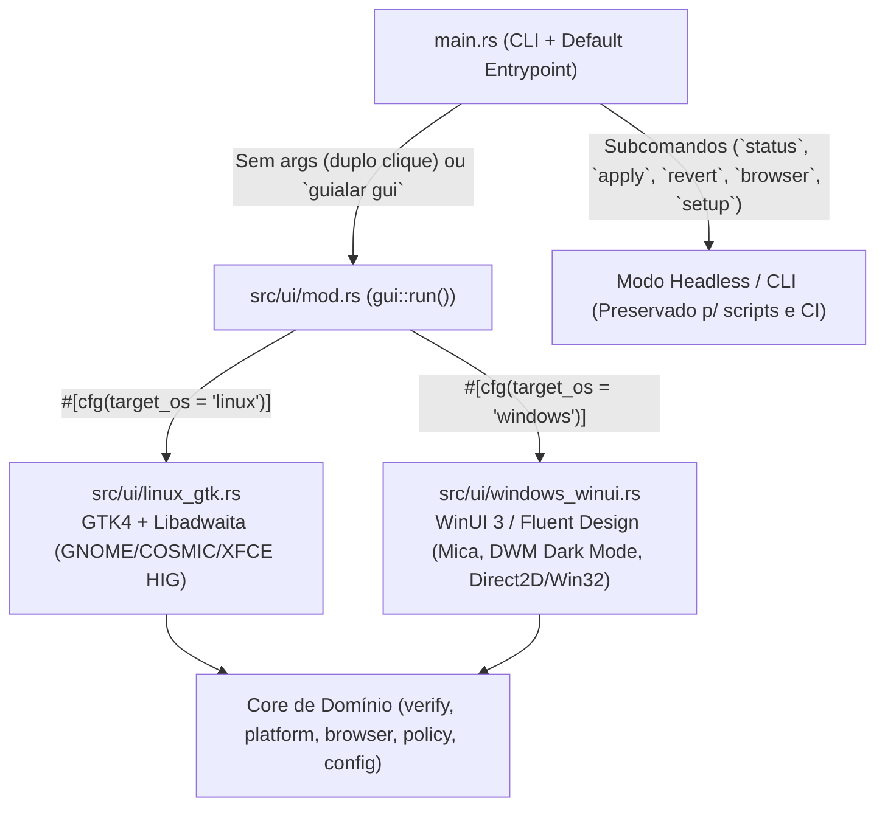

# ADR-018 — Arquitetura de Interface Gráfica Nativa por SO (GTK4/Libadwaita no Linux e WinUI/Fluent no Windows)

- **Status:** Aceito (Revoga ADR-003 da Trilha Rust que previa `egui`/`eframe`)
- **Data:** 08/11/2026
- **Autor:** `gl-arquiteto` (Arquiteto do `guialar-digital`)
- **Alvo:** `guialar-rs` v0.3.0

---

## 1. Contexto e Problema ("Por que parecia um vírus?")

Na versão `0.2.1`, ao dar duplo clique em `guialar.exe` no Windows ou executar o binário sem argumentos:
1. O binário é compilado com subsistema `console` (`pe32+ console`), abrindo uma **janela preta de terminal (`conhost.exe` / PowerShell)** com emojis e perguntas `[S/n]`.
2. Não possui **ícone de aplicativo** embutido no PE (aparece o ícone genérico de executável desconhecido do Windows).
3. Não possui **Metadados `VERSIONINFO`** (`CompanyName`, `ProductName`, `FileDescription`, `LegalCopyright`) nem **Manifesto de Aplicação (`application.manifest`)** com suporte a High-DPI (`PerMonitorV2`) e `Common Controls v6`.
4. Ao tentar aplicar o DNS, dispara processos `powershell.exe` secundários, comportamento típico de *droppers* ou scripts maliciosos.

O usuário determinou:
> *"use gtk no linux e winUI no windows, quero entregar uma interface q realmente pareça um programa integrado ao SO"*

---

## 2. Decisão Arquitetural

### 2.1. Revogação do `egui` (ADR-003) e Adoção de UI Nativa Dual (`src/ui/`)
Abandonamos qualquer toolkit *immediate-mode* genérico (`egui`/`iced`) que desenha widgets próprios com cara de motor de jogo. O `guialar-rs` terá uma **camada de apresentação nativa por sistema operacional (`src/ui/mod.rs`)**, acionada por padrão quando o programa é aberto sem argumentos (duplo clique) ou via subcomando `guialar gui`:



### 2.2. Especificação da Interface no Linux (`src/ui/linux_gtk.rs`)
- **Tecnologia:** **GTK 4 (`libgtk-4.so.1`) + Libadwaita (`libadwaita-1.so.0`)**.
- **Estratégia de Compilação e Portabilidade (AppImage / Static-friendly):**
  - Para não exigir dezenas de pacotes `-dev` no host durante o build e para permitir que o **mesmo binário** funcione tanto em distros com `libadwaita-1` + `libgtk-4` quanto em distros minimalistas (ou com fallback automático para `gtk4` puro / CLI se `DISPLAY`/`WAYLAND_DISPLAY` não existir), carregar os símbolos C da `libadwaita-1.so.0`, `libgtk-4.so.1`, `libgio-2.0.so.0`, `libgobject-2.0.so.0` e `libglib-2.0.so.0` (ou via crates `gtk4`/`libadwaita` com `nix-shell`/Docker builder, ou FFI dinâmico `dlopen` ultra-leve que mantém compilação instantânea e zero quebra em musl/glibc).
  - **Nota técnica importante sobre `musl` vs `glibc` no Linux:** `dlopen` de bibliotecas gráficas do sistema (`libgtk-4.so.1`, `libadwaita-1.so.0`) exige que o binário Linux principal use target `x86_64-unknown-linux-gnu` (ou que o `AppImage` empacote/use o runtime do host). Se o binário for `musl` estático puro, `dlopen` de `.so` linkadas contra `glibc` falha! Portanto:
    - O binário Linux com GUI deve ser compilado para `x86_64-unknown-linux-gnu` (compatível com Debian Bookworm / Fedora / Void glibc), OU usar um helper / camada FFI `gnu` dentro do AppImage.
    - Quando executado sem servidor gráfico (`DISPLAY` e `WAYLAND_DISPLAY` vazios, ex.: via SSH em servidor), faz fallback gracioso para o resumo visual no terminal sem crashar.
- **Visual e Componentes (GNOME / Libadwaita HIG):**
  - `AdwApplication` (`br.uniube.pi.guialar`) + `AdwApplicationWindow` (largura padrão `640`, altura `580`, redimensionável) + `AdwHeaderBar` integrada à barra de título.
  - **Hero Card de Status (`AdwStatusPage` ou `AdwPreferencesGroup`):**
    - Ícone vetorial simbólico grande (`security-high-symbolic` verde quando Protegido, `security-medium-symbolic` âmbar quando Parcial, `security-low-symbolic` vermelho quando Desprotegido).
    - Título claro: **"Proteção Familiar Ativa"** / **"Computador Desprotegido"** / **"Configuração Parcial"**.
    - Subtítulo amigável explicando o filtro DNS Cloudflare for Families (`1.1.1.3` / `1.0.0.3` — bloqueio de malware e conteúdo adulto).
  - **Grupo "Ações de Proteção" (`AdwPreferencesGroup`):**
    - `AdwActionRow` **"Filtro de Rede (DNS Seguro)"** com subtítulo mostrando o backend detectado (`NetworkManager`, `systemd-resolved`, `runit/resolvconf`) e botão de ação principal com estilo `.suggested-action` (**"Ativar Proteção"**) ou `.destructive-action` (**"Desativar / Restaurar DNS Original"**) quando já protegido.
    - `AdwActionRow` **"Bloqueador de Anúncios (uBlock Origin)"** listando os navegadores detectados (Firefox, Chrome, Brave, Edge, Chromium) e botão **"Proteger Navegadores"** que abre/aplica a extensão.
    - `AdwActionRow` **"Diagnóstico da Rede"** com botão **"Verificar Agora"** (roda `verify::check_status()` em thread separada com `GtkSpinner` para nunca travar a UI).
  - **Expansor "Detalhes Técnicos e Registro de Eventos" (`AdwExpanderRow`):**
    - Mostra IPs DNS ativos, caminho do manifesto (`~/.config/guialar/state.json`), distro detectada e log de execução em fonte monoespaçada.

### 2.3. Especificação da Interface no Windows (`src/ui/windows_winui.rs`)
- **Identidade de Produto Legítimo (Fim da "Cara de Vírus"):**
  1. **`#![windows_subsystem = "windows"]` (ou detecção dinâmica de console `AttachConsole(ATTACH_PARENT_PROCESS)`):**
     - Ao abrir por **duplo clique no Explorer**, **NUNCA** abre janela preta de prompt (`cmd`/`conhost`). Abre diretamente a janela gráfica nativa WinUI/Fluent!
     - Ao rodar a partir de um terminal existente (`powershell` ou `cmd`: `guialar status`, `guialar --version`, `guialar setup`, etc.), anexa ao console pai (`AttachConsole`) ou escreve em `stdout`/`stderr` normalmente, mantendo **100% de compatibilidade com os testes de CLI do QA**.
  2. **Recurso Win32 Embutido (`.rc` compilado no `.exe` via `llvm-rc` / `windres` / `embed-resource`):**
     - **Ícone de Escudo Oficial (`guialar.ico`)** em múltiplas resoluções (16×16, 32×32, 48×48, 256×256 PNG) desenhado programaticamente (escudo azul/esmeralda `#0B5F63` com check branco) para que o `.exe` tenha ícone próprio no Explorer, na barra de tarefas e na barra de título.
     - **`VERSIONINFO` Completo:**
       - `ProductName`: `"GuiaLar Digital"`
       - `FileDescription`: `"GuiaLar Digital — Proteção Familiar de Rede e Navegadores"`
       - `CompanyName`: `"Projeto GuiaLar Digital (Uniube)"`
       - `FileVersion` / `ProductVersion`: `"0.3.0.0"`
       - `LegalCopyright`: `"Copyright (c) 2026 GuiaLar Digital — Licença MIT"`
     - **`application.manifest` Embutido (`RT_MANIFEST`):**
       - `dpiAwareness`: `PerMonitorV2` (fontes perfeitamente nítidas em qualquer escala de tela).
       - Dependência `Microsoft.Windows.Common-Controls` versão `6.0.0.0` (visual moderno de controles e diálogos do Windows 11).
       - `requestedExecutionLevel level="asInvoker"` (para o usuário abrir o programa sem susto de tela amarela/azul imediata; o escudo UAC aparece apenas no botão **"Ativar Proteção"** / **"Restaurar"**, igual aos utilitários oficiais da Microsoft).
- **Visual e Tecnologia WinUI 3 / Fluent Design para Windows 11:**
  - Como o `Windows App SDK` (`Microsoft.UI.Xaml.dll`) externo exige instalador MSIX ou runtime redistribuível de ~60 MB que quebraria o requisito de executável único portátil (`guialar.exe` standalone), implementaremos a **janela nativa Windows 11 Fluent / WinUI** diretamente sobre as APIs nativas do Windows 11 (`dwmapi` + `uxtheme` + `gdiplus`/`Direct2D` + `comctl32` v6):
    - **Backdrop Mica / Acrylic Nativo do Windows 11:** `DwmSetWindowAttribute` com `DWMWA_SYSTEMBACKDROP_TYPE = DWMSBT_MAINWINDOW` (valor `2` = Mica nativo da WinUI 3) e `DWMWA_WINDOW_CORNER_PREFERENCE = DWMWCP_ROUND` (cantos arredondados nativos).
    - **Dark / Light Mode Automático do Windows 11:** Lê `HKCU\Software\Microsoft\Windows\CurrentVersion\Themes\Personalize\AppsUseLightTheme` e aplica `DWMWA_USE_IMMERSIVE_DARK_MODE` na barra de título + paleta de cores oficial **WinUI 3 Fluent Design**:
      - *Light Theme:* Fundo Mica `#F3F3F3`, Cards em `#FFFFFF` com borda sutil `#E5E5E5` e cantos arredondados (`8px`), texto primário `#1A1A1A`, texto secundário `#5D5D5D`, Accent Button Win11 `#0067C0` / Teal `#0B5F63`.
      - *Dark Theme:* Fundo Mica `#202020`, Cards em `#2B2B2B` com borda `#3A3A3A`, texto primário `#FFFFFF`, texto secundário `#C5C5C5`, Accent Button `#60CDFF` / `#4CC38A`.
    - **Tipografia Oficial Windows 11:** Fonte **`Segoe UI Variable Display`** (com fallback para `Segoe UI`), hierarquia tipográfica WinUI 3 (`TitleLarge` 22pt Semibold, `Subtitle` 14pt Semibold, `Body` 10.5pt Regular, `Caption` 9pt).
    - **Layout em Cartões WinUI 3 (Settings-like Card Layout, 720×560 dp):**
      1. **Cabeçalho Fluent:** Ícone do Escudo GuiaLar renderizado com anti-aliasing + Título `"GuiaLar Digital"` + Subtítulo `"Segurança familiar e proteção de navegação para Windows 11"` + Botão de alternar Tema Claro/Escuro.
      2. **Hero Banner de Status (Card Principal):**
         - Badge circular com ícone Fluent (`Segoe Fluent Icons` / `Segoe MDL2 Assets`: `Shield` `\uE83D` / `CheckMark` `\uE73E` / `Warning` `\uE7BA`).
         - Estado atual em destaque: **"Proteção Ativa (Cloudflare Family)"** (verde `#0F7B0F`), **"Configuração Parcial"** (âmbar `#9D5D00`) ou **"Desprotegido — DNS Padrão da Rede"** (vermelho `#C42B1C`).
         - Descrição clara do que está ativo (`1.1.1.3` / `1.0.0.3` + status das políticas de navegador).
      3. **Cartões de Ação (`SettingCard` estilo Windows 11 Settings / Windows Security):**
         - **Card 1 — Proteção Completa (1-Clique):** *"Ativar DNS Seguro + Bloqueador de Anúncios (uBlock Origin Lite)"* com botão primário com ícone UAC Shield (`BCM_SETSHIELD` ou ícone Fluent) **"Ativar Proteção Familiar"**.
         - **Card 2 — Navegadores Detectados:** Mostra ícones/badges para Microsoft Edge, Google Chrome, Brave e Mozilla Firefox (instalados vs não instalados) e se a política `ExtensionInstallForcelist` / `policies.json` está aplicada, com botão **"Aplicar nos Navegadores"**.
         - **Card 3 — Restauração e Diagnóstico:** Botão **"Restaurar Padrão da Rede (Desfazer)"** (reverte DNS **e** remove as políticas do uBlock gravadas pelo GuiaLar) + Botão **"Testar Conexão Agora"**.
      4. **Barra de Status / Log Expansível na Base:** Mostra feedback em tempo real sem piscar janelas de comando (`CREATE_NO_WINDOW` em todas as chamadas internas ao PowerShell!).

---

## 3. Regra Crítica Anti-"Cara de Vírus" no Windows (`CREATE_NO_WINDOW`)

1. **Zero Janelas Piscando (`CREATE_NO_WINDOW = 0x08000000`):**
   - Toda execução de `powershell.exe` em `src/platform/windows.rs` **DEVE** usar `.creation_flags(0x0800_0000)` (`CREATE_NO_WINDOW`). Hoje, quando o usuário clica, janelas azuis/pretas do PowerShell piscam na tela — isso é exatamente o que faz parecer malware. Com `CREATE_NO_WINDOW`, o PowerShell roda invisível em background e o resultado aparece suavemente dentro da janela WinUI do GuiaLar.
2. **Elevação UAC Limpa (`ShellExecuteExW` com `runas` e `--internal-gui-setup` / `--internal-apply`):**
   - Quando a GUI não estiver elevada e o usuário clicar em **"Ativar Proteção"** ou **"Restaurar"**, o processo elevado auxiliar roda com `SW_HIDE` (sem abrir janela de terminal) e a GUI principal atualiza o cartão de status automaticamente assim que o processo elevado termina (`WaitForSingleObject` no `hProcess` do `SHELLEXECUTEINFOW`!).

---

## 4. Limites de Módulo e Estrutura de Pastas (`guialar-rs`)

```text
guialar-rs/
├── Cargo.toml
├── build.rs                  # Compila recursos Windows (.rc -> ícone, VERSIONINFO, manifest DPI/ComCtl6)
├── assets/
│   ├── guialar.ico           # Ícone multi-resolução gerado/versionado
│   ├── guialar.svg           # Ícone vetorial Linux Desktop / AppImage
│   ├── app.manifest          # Manifesto Win32 (PerMonitorV2, CommonControls v6, asInvoker)
│   └── guialar.rc            # Script de recursos Win32
└── src/
    ├── main.rs               # Roteamento: sem args -> ui::run(); com args -> CLI headless
    ├── browser.rs            # Detecção de navegadores
    ├── config.rs             # Manifesto de rollback (~/.config/guialar/state.json)
    ├── policy.rs             # Políticas uBlock (incluindo revert_all() no Windows!)
    ├── sysutil.rs            # Utilitários seguros sem fork
    ├── verify.rs             # Smoke test DNS Cloudflare Family (1.1.1.3 / 1.0.0.3)
    ├── platform/
    │   ├── mod.rs
    │   ├── linux.rs          # Backends NM, systemd-resolved, runit/resolvconf
    │   └── windows.rs        # PowerShell invisível (CREATE_NO_WINDOW) + UAC WaitForSingleObject
    └── ui/
        ├── mod.rs            # Interface pública `pub fn run() -> anyhow::Result<()>`
        ├── theme.rs          # Tokens de cor (Light/Dark Fluent & Libadwaita) e textos amigáveis
        ├── linux_gtk.rs      # Implementação GTK4 + Libadwaita no Linux
        └── windows_winui.rs  # Implementação WinUI / Fluent Design no Windows 11
```

---

## 5. Plano de Execução com o Time (Quem faz o quê)

1. **`gl-refatorador` (Implementação Rust v0.3.0):**
   - Criar `src/ui/` (`mod.rs`, `theme.rs`, `linux_gtk.rs`, `windows_winui.rs`) e `build.rs` + `assets/` (`guialar.ico`, `app.manifest`, `guialar.rc`).
   - No Windows: usar `#![cfg_attr(not(test), windows_subsystem = "windows")]` com `AttachConsole(ATTACH_PARENT_PROCESS)` quando invocado com argumentos de CLI (garantindo que `guialar --version`, `status`, `apply`, `revert` continuem funcionando no terminal/SSH para o QA, enquanto o duplo clique sem argumentos abre a GUI WinUI/Fluent sem janela de console).
   - Adicionar `creation_flags(0x08000000)` (`CREATE_NO_WINDOW`) em todas as chamadas ao `powershell` em `src/platform/windows.rs` e usar `ShellExecuteExW` (`SEE_MASK_NOCLOSEPROCESS`, `SW_HIDE`) para aguardar a conclusão da elevação UAC sem abrir janela preta.
   - No Linux: implementar a interface **GTK4 + Libadwaita** em `src/ui/linux_gtk.rs` (com fallback limpo se sem display) e empacotar o binário/AppImage `0.3.0`.
   - Adicionar também `policy::revert_all()` no `revert` do Windows para limpar as chaves `ExtensionInstallForcelist` criadas no registro.
2. **`gl-reviewer` (Revisão de Código e UX/Segurança):**
   - Auditar `src/ui/linux_gtk.rs`, `src/ui/windows_winui.rs`, `build.rs` e `src/platform/windows.rs` (verificar ausência de janelas de console piscando, segurança de memória no FFI Win32/GTK4, responsividade da thread de UI durante o smoke test de DNS e remoção correta das políticas no `revert`).
3. **`gl-qa` (Testes Automatizados + Validação Visual nas VMs QEMU):**
   - Validar que a suíte CLI existente (Linux e Windows) continua 100% verde.
   - Iniciar a GUI no Linux (`fedora` / `void`) e no Windows 11 (`win11`), capturar screenshots (`vm shot` / `/tmp/win11-gui.png` e `/tmp/linux-gui.png`) comprovando o visual nativo WinUI no Windows 11 e GTK4/Libadwaita no Linux, e testar o clique de ativação/desativação pela interface.
4. **`gl-devops` (Empacotamento Desktop e Exibição na VM Windows 11):**
   - Atualizar o `.AppImage` (com ícone `.svg` e `.desktop` integrados ao sistema) e o `guialar-0.3.0-windows.exe` (com ícone `.ico`, `VERSIONINFO` e manifesto embutidos), disponibilizar na VM `win11` aberta na tela do usuário e deixar a janela gráfica aberta na área de trabalho do Windows 11 para inspeção imediata.
